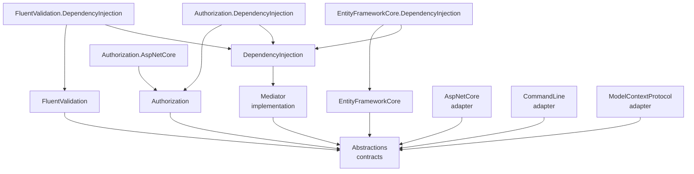

# Architecture

This document is for maintainers: how Datapoint.Mediator is put together, and what must stay true when you change it. To *use* the packages, read the [manual](docs/README.md) instead. The reasons behind each design choice are in the [decision records](docs/adr/README.md).

## Code map

All package names start with `Datapoint.Mediator.`, except the implementation, which is `Datapoint.Mediator` itself.

| Project | Role | External dependencies |
|---|---|---|
| `Abstractions` | Commands, queries, messages, handlers, `IBehavior`, `IMediator`, `ITransactionContext`, and the action contracts (`[Action]`, `IActionCatalog`, `IActionDispatcher`, their exceptions). Domain layers reference only this. | none |
| `Mediator` | `ServiceProviderMediator`, the dispatchers, `ActionCatalog`, `ActionDispatcher`, `ActionArguments` and `MediatorTelemetry`. | none |
| `DependencyInjection` | `AddMediator`, `MediatorOptions`, handler scanning, and building the action catalog. | `Microsoft.Extensions.DependencyInjection.Abstractions` |
| `FluentValidation` | `ValidationBehavior`. | FluentValidation |
| `Authorization` | `AuthenticationBehavior`, `AuthorizationBehavior` and its options, `IAuthorizer<T>` and its decisions, `IAuthorizationContext`, `IAuthorizationObserver`, `IPrincipalAccessor`, `FixedPrincipalAccessor`, `[AllowAnonymousAccess]` and the two exceptions. | none |
| `Authorization.AspNetCore` | `HttpPrincipalAccessor` and `AddHttpPrincipalAccessor`. | ASP.NET Core (framework reference) |
| `EntityFrameworkCore` | `TransactionBehavior<TDbContext>`, its options, `ITransactionInitializer<TDbContext>`, `TransactionContext` and `[NonTransactional]`. | EF Core (relational) |
| `*.DependencyInjection` | The `Add…Behavior()` and `Add…Accessor()` registration methods for each feature. | — |
| `AspNetCore` | `MapMediatorActions`: one `POST` endpoint per action. | ASP.NET Core (framework reference) |
| `CommandLine` | `AddMediatorActions`: one command per action. | System.CommandLine |
| `ModelContextProtocol` | `WithMediatorActions`: one MCP tool per action. | ModelContextProtocol SDK |

Outside `src/`:
- `tests/` has one test project per package, plus `DependencyInjection.Tests.Fixtures`, an assembly for scanning tests.
- `benchmarks/` measures dispatch with BenchmarkDotNet.
- `samples/` shows one business layer offered from three hosts.

## Dispatch

`ServiceProviderMediator.SendAsync(command)` receives a command typed as an interface, so it has to find the handler for the command's concrete type:

1. **Find the dispatcher.** `CommandDispatcher.Get(command.GetType())` returns a cached `CommandDispatcher<TCommand>`. It's created once per type with `MakeGenericType` and stored in a static `ConcurrentDictionary`. Each kind has its own dispatcher type under `src/Datapoint.Mediator/Dispatchers/`.
2. **Resolve.** The dispatcher resolves `ICommandHandler<TCommand>` and every `IBehavior` from the caller's `IServiceProvider`, which is the current DI scope.
3. **Run.**
   - With **no behaviours**, it calls the handler directly.
   - Otherwise, `InvokePipelineAsync` builds the pipeline from the innermost behaviour outwards, so the first registered behaviour runs first, and runs it. Each behaviour gets a `next` delegate.
   - The pipeline lives in a separate method, so its closures are only allocated when there are behaviours. Dispatch without behaviours allocates 0 bytes ([ADR 0006](docs/adr/0006-cached-generic-dispatchers.md)).
4. **Observe.** When telemetry is being listened to, `ServiceProviderMediator` wraps the dispatch in a span and records its duration (see [Telemetry](#telemetry)).

Messages are the exception: `MessageDispatcher` resolves every `IMessageHandler<TMessage>` and runs them one after another, in registration order. The first exception stops the rest ([ADR 0009](docs/adr/0009-messages-run-in-the-callers-transaction.md)).

Stream queries return an `IAsyncEnumerable<T>`. The handler is resolved when `StreamAsync` is called, but runs when the results are enumerated.

## Behaviours

`IBehavior` has one `HandleAsync` overload per kind, and each one defaults to calling `next` ([ADR 0005](docs/adr/0005-one-behavior-interface.md)). The built-in behaviours override only what they need:

| Behaviour | Commands | Queries | Stream queries | Messages |
|---|---|---|---|---|
| `AuthenticationBehavior` | ✓ | ✓ | ✓ | — |
| `AuthorizationBehavior` | ✓ | ✓ | ✓ | not authorized ([ADR 0008](docs/adr/0008-messages-are-not-authorized.md)); only clears the decision |
| `ValidationBehavior` | ✓ | ✓ | ✓ | — |
| `TransactionBehavior<TDbContext>` | ✓ | opt-in, read-only | opt-in, read-only | — |

Behaviours that read attributes, such as `[AllowAnonymousAccess]` or `[NonTransactional]`, cache the result per type in a static `ConcurrentDictionary`. Behaviours that need services per action type, such as `IAuthorizer<T>` or `IValidator<T>`, take `IServiceProvider` and resolve them on each dispatch.

### Authorization

`AuthorizationBehavior` gets the user from `IPrincipalAccessor`, then runs the action's authorizers through a cached `ActionAuthorization<TAction>`, stopping at the first denial. The combined `AuthorizationResult` goes to every `IAuthorizationObserver`, then either an exception is thrown or the result is stored in `AuthorizationContext`'s static `AsyncLocal` before `next` runs ([ADR 0025](docs/adr/0025-decisions-bound-to-their-request.md)):
- The value is set inside an `async` method, so it flows into `next` and the caller gets its own value back when the method returns. Don't set it from a non-`async` method.
- Anonymous actions and messages clear it, so they never see an outer decision. Handlers read it with `GetResultFor(action)`, which checks that the decision was made for that instance.
- For stream queries, the behaviour enumerates `next` itself and sets the value before every `MoveNextAsync`, because an async iterator runs each step in its consumer's context.
- Decision details never go into exception messages.

### Transactions

`TransactionBehavior<TDbContext>` begins a transaction for each command (and, when switched on, each query) inside the context's execution strategy, then runs the read-only statement, the initializers and `next`, and saves and commits, or rolls back for queries ([ADR 0024](docs/adr/0024-read-only-query-transactions.md)):
- The state of the current transaction is a `TransactionState` in `TransactionContext`'s static `AsyncLocal`, set inside `async` methods like the authorization decision, so nested and parallel requests see their own. It records the context instance that began the transaction, so a behaviour for another context doesn't mistake it for its own.
- When `Database.CurrentTransaction` is set, the request joins: if the state belongs to this context, initializers run with `IsJoined`; otherwise the transaction is foreign, and is joined as it is or refused ([ADR 0023](docs/adr/0023-whoever-begins-a-transaction-commits-it.md)).
- Stream queries begin their transaction at first enumeration, set the state before every `MoveNextAsync`, and rely on disposing the uncommitted transaction to roll it back. A retrying strategy refuses them.

## Actions

Actions let hosts dispatch commands and queries by name, with JSON arguments ([ADR 0032](docs/adr/0032-actions-declare-the-adapters-that-offer-them.md)).

1. **Registration.** `AddMediator` collects the request types of every registered handler and adds them to an `ActionCatalogBuilder`. That builder is a singleton instance kept in the service collection, so every `AddMediator` call adds to the same catalog. Each `Add` builds a new `ActionCatalog`, which validates everything at that moment: name pattern and length, duplicates, empty descriptions ([ADR 0031](docs/adr/0031-every-action-has-a-description.md)), actions without a channel attribute, messages marked as actions, and types implementing more than one action interface. So **invalid actions fail at startup**.
   After the catalog, the builder runs every startup check registered with `MediatorOptions.AddStartupCheck`, by any `AddMediator` call, over every command, query and stream query so far ([ADR 0027](docs/adr/0027-startup-checks.md)).
2. **Catalog.** `IActionCatalog` (a singleton) lists every action, with its name, description, kind, action type and result type. Each `ActionDescriptor` also finds, once, the properties marked `[HostProvided]` on the property or its record parameter, so every adapter applies the same rule ([ADR 0028](docs/adr/0028-host-provided-properties.md)), and the channel attributes (`[Api]`, `[CommandLine]`, `[ModelContextProtocol]` or a custom one) that `IsOfferedBy<TChannel>()` checks.
3. **Dispatch.** `ActionDispatcher` (scoped) looks a name up in the catalog. An unknown name throws `ActionNotFoundException`. The dispatcher doesn't check channels: each adapter only dispatches the actions it offers. It then deserializes the `JsonElement` into the action type with `ActionArguments`, throwing `InvalidActionArgumentsException` without echoing the input. When deserialization fails, the internal `ArgumentField` turns the `JsonException`'s path into a `Field` by walking the action's `JsonTypeInfo`: it writes only the contract's names, stops before dictionary keys, polymorphic types and custom converters, returns `null` for unknown properties, and finds a missing required property by scanning the JSON at the object it's missing from. It also sets a `Reason` from the same walk: `Missing` for that missing property, `Null` when the value it reached is JSON `null`, and `Invalid` otherwise ([ADR 0033](docs/adr/0033-argument-errors-give-a-reason.md)). The dispatcher sends it through `IMediator` with a cached `ActionInvoker` for the action's kind. Every behaviour runs as usual.
4. **Hosts.** Each adapter reads the catalog when the app starts:

| Adapter | Built from the catalog | Error mapping |
|---|---|---|
| `AspNetCore` (`ActionEndpoints`) | `POST {prefix}/{name with dots as slashes}`, with OpenAPI metadata | 400, 401, 403, then `MapException`, then rethrow |
| `CommandLine` (`ActionCommand`) | a subcommand per dot segment, with typed options parsed with the invariant culture, and a `--json` fallback | exit codes 2, 3, 4, then `ErrorMessage`, then 70 |
| `ModelContextProtocol` (`ActionTool`, `ActionToolsSetup`) | a tool per action, named with dots as underscores, with a JSON schema | `ErrorMessage` or `ErrorContent`, then safe messages, then a generic error, all returned as `isError` results ([0037](docs/adr/0037-mcp-never-rethrows.md)) |

The adapters recognise the authorization exceptions by their full type name, so they don't depend on the authorization package ([ADR 0013](docs/adr/0013-adapters-match-authorization-exceptions-by-name.md)). They describe invalid arguments from `InvalidActionArgumentsException.Field`, never from its message, after passing it to the app's hook, and never describe any other exception. The CLI and MCP adapters also pass the authorization exceptions to their hook, which words them but can't change the exit code or turn the result into a success ([ADR 0034](docs/adr/0034-hooks-word-every-known-error.md)).

The CLI and MCP adapters hide host-provided properties, and refuse a caller's value for one, matching JSON names with `StringComparer.OrdinalIgnoreCase`. They check the caller's arguments before resolving `IActionDispatcher`, so an app's decorator of the dispatcher can set the value afterwards. ASP.NET Core and the dispatcher don't treat them differently.

## Telemetry

`MediatorTelemetry` owns an `ActivitySource` and a `Meter`, both named `Datapoint.Mediator`. Each dispatch:
- produces a span named after the operation and the action type, such as `send CreateInvoice`;
- records its duration in a histogram;
- tags `datapoint.mediator.operation` (`send`, `query`, `stream` or `publish`), `datapoint.mediator.action` with the action's full type name, and on failure, `error.type` with the exception's full type name.

Exception messages are never recorded. When nothing listens, the dispatch isn't wrapped at all.

## Invariants

Any change must keep these true. Tests cover each one, and the linked records explain why.

- **Authorization fails closed:** an action with no authorizer is denied, a `null` decision is a denial, and no user means `AuthenticationRequiredException` ([0025](docs/adr/0025-decisions-bound-to-their-request.md)).
- **Decisions are bound to their request, and their details never reach the caller:** `For(action)` checks the instance, message handlers see no decision, details are never in exception messages, and an observer that throws stops the action ([0025](docs/adr/0025-decisions-bound-to-their-request.md)).
- **Messages are not authorized,** and can never be actions ([0008](docs/adr/0008-messages-are-not-authorized.md)).
- **An adapter offers only the actions marked for it, and one it doesn't offer is indistinguishable from an unknown one** ([0032](docs/adr/0032-actions-declare-the-adapters-that-offer-them.md)).
- **The CLI and MCP adapters never take a host-provided value from the caller:** they hide the property and refuse a value for it, in any letter case ([0028](docs/adr/0028-host-provided-properties.md)).
- **No adapter echoes input or exception details:** invalid arguments are described only by a `Field` built from the action's contract, and telemetry never records exception messages ([0034](docs/adr/0034-hooks-word-every-known-error.md)).
- **Every adapter maps both authorization exceptions** by their full type names ([0013](docs/adr/0013-adapters-match-authorization-exceptions-by-name.md)).
- **One `IPrincipalAccessor` per app:** the registration methods refuse a second one ([0014](docs/adr/0014-one-principal-accessor.md)).
- **Dispatch without behaviours allocates nothing:** check with the benchmarks ([0006](docs/adr/0006-cached-generic-dispatchers.md)).
- **Invalid action configurations fail in `AddMediator`,** never at the first request ([0032](docs/adr/0032-actions-declare-the-adapters-that-offer-them.md)).
- **`RequireTransaction` is enforced** at startup (`[NonTransactional]` authorized actions) and at runtime (no active `ITransactionContext`), so a misordered pipeline can't silently authorize outside the transaction ([0020](docs/adr/0020-commands-authorized-inside-their-transaction.md)).
- **Settings are never silently ignored:** a behaviour registered with a factory can't be registered again ([0027](docs/adr/0027-startup-checks.md)).
- **Handlers and behaviours resolve from the caller's scope:** `IMediator` and `IActionDispatcher` are scoped, and `IActionCatalog` is a singleton.
