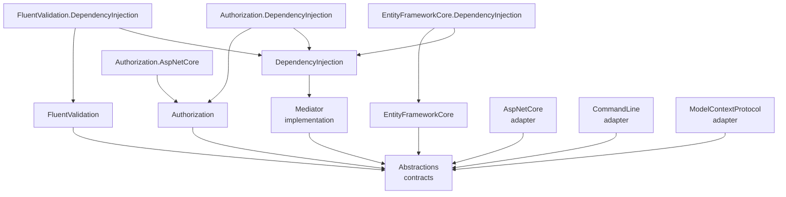

# Architecture

This document is for maintainers: how Datapoint.Mediator is put together, and what must stay true when you change it. To *use* the packages, read the [manual](docs/README.md) instead. The reasons behind each design choice are in the [decision records](docs/adr/README.md).

## Code map

All package names start with `Datapoint.Mediator.`, except the implementation, which is `Datapoint.Mediator` itself.

| Project | Role | External dependencies |
|---|---|---|
| `Abstractions` | Commands, queries, messages, handlers, `IBehavior`, `IMediator`, and the action contracts (`[Action]`, `IActionCatalog`, `IActionDispatcher`, their exceptions). Domain layers reference only this. | none |
| `Mediator` | `Mediator`, the dispatchers, `ActionCatalog`, `ActionDispatcher` and `MediatorTelemetry`. | none |
| `DependencyInjection` | `AddMediator`, `MediatorOptions`, handler scanning, and building the action catalog. | `Microsoft.Extensions.DependencyInjection.Abstractions` |
| `FluentValidation` | `ValidationBehavior`. | FluentValidation |
| `Authorization` | `AuthorizationBehavior`, `IAuthorizer<T>`, `IPrincipalAccessor`, `FixedPrincipalAccessor`, `[AllowAnonymousAccess]` and the two exceptions. | none |
| `Authorization.AspNetCore` | `HttpPrincipalAccessor` and `AddHttpPrincipalAccessor`. | ASP.NET Core (framework reference) |
| `EntityFrameworkCore` | `TransactionBehavior<TDbContext>` and `[NonTransactional]`. | EF Core |
| `*.DependencyInjection` | The `Add…Behavior()` and `Add…Accessor()` registration methods for each feature. | — |
| `AspNetCore` | `MapActions`: one `POST` endpoint per action. | ASP.NET Core (framework reference) |
| `CommandLine` | `AddActions`: one command per action. | System.CommandLine |
| `ModelContextProtocol` | `WithMediatorActions`: one MCP tool per action. | ModelContextProtocol SDK |

Outside `src/`:
- `tests/` has one test project per package, plus `DependencyInjection.Tests.Fixtures`, an assembly for scanning tests.
- `benchmarks/` measures dispatch with BenchmarkDotNet.
- `samples/` shows one business layer offered from three hosts.

## Dispatch

`Mediator.SendAsync(command)` receives a command typed as an interface, so it has to find the handler for the command's concrete type:

1. **Find the dispatcher.** `CommandDispatcher.Get(command.GetType())` returns a cached `CommandDispatcher<TCommand>`. It's created once per type with `MakeGenericType` and stored in a static `ConcurrentDictionary`. Each kind has its own dispatcher type under `src/Datapoint.Mediator/Dispatchers/`.
2. **Resolve.** The dispatcher resolves `ICommandHandler<TCommand>` and every `IBehavior` from the caller's `IServiceProvider`, which is the current DI scope.
3. **Run.**
   - With **no behaviours**, it calls the handler directly.
   - Otherwise, `InvokePipelineAsync` builds the pipeline from the innermost behaviour outwards, so the first registered behaviour runs first, and runs it. Each behaviour gets a `next` delegate.
   - The pipeline lives in a separate method, so its closures are only allocated when there are behaviours. Dispatch without behaviours allocates 0 bytes ([ADR 0006](docs/adr/0006-cached-generic-dispatchers.md)).
4. **Observe.** When telemetry is being listened to, `Mediator` wraps the dispatch in a span and records its duration (see [Telemetry](#telemetry)).

Messages are the exception: `MessageDispatcher` resolves every `IMessageHandler<TMessage>` and runs them one after another, in registration order. The first exception stops the rest ([ADR 0009](docs/adr/0009-messages-run-in-the-callers-transaction.md)).

Stream queries return an `IAsyncEnumerable<T>`. The handler is resolved when `StreamAsync` is called, but runs when the results are enumerated.

## Behaviours

`IBehavior` has one `HandleAsync` overload per kind, and each one defaults to calling `next` ([ADR 0005](docs/adr/0005-one-behavior-interface.md)). The built-in behaviours override only what they need:

| Behaviour | Commands | Queries | Stream queries | Messages |
|---|---|---|---|---|
| `AuthorizationBehavior` | ✓ | ✓ | ✓ | — ([ADR 0008](docs/adr/0008-messages-are-not-authorized.md)) |
| `ValidationBehavior` | ✓ | ✓ | ✓ | — |
| `TransactionBehavior<TDbContext>` | ✓ | — | — | — |

Behaviours that read attributes, such as `[AllowAnonymousAccess]` or `[NonTransactional]`, cache the result per type in a static `ConcurrentDictionary`. Behaviours that need services per action type, such as `IAuthorizer<T>` or `IValidator<T>`, take `IServiceProvider` and resolve them on each dispatch.

## Actions

Actions let hosts dispatch commands and queries by name, with JSON arguments ([ADR 0011](docs/adr/0011-named-actions.md)).

1. **Registration.** `AddMediator` collects the request types of every registered handler and adds them to an `ActionCatalogBuilder`. That builder is a singleton instance kept in the service collection, so every `AddMediator` call adds to the same catalog. Each `Add` builds a new `ActionCatalog`, which validates everything at that moment: name pattern and length, duplicates, messages marked as actions, and types implementing more than one action interface. So **invalid actions fail at startup**.
2. **Catalog.** `IActionCatalog` (a singleton) lists the visible actions, with their name, description, kind, action type and result type. Hidden actions aren't listed.
3. **Dispatch.** `ActionDispatcher` (scoped) looks a name up in the catalog. An unknown name and a hidden one both throw the same `ActionNotFoundException`. It then deserializes the `JsonElement` into the action type, throwing `InvalidActionArgumentsException` without echoing the input, and sends it through `IMediator` with a cached `ActionInvoker` for the action's kind. Every behaviour runs as usual.
4. **Hosts.** Each adapter reads the catalog when the app starts:

| Adapter | Built from the catalog | Error mapping |
|---|---|---|
| `AspNetCore` (`ActionEndpoints`) | `POST {prefix}/{name with dots as slashes}`, with OpenAPI metadata | 400, 401, 403, then `MapException`, then rethrow |
| `CommandLine` (`ActionCommand`) | a subcommand per dot segment, with typed options and a `--json` fallback | exit codes 2, 3, 4, then `ErrorMessage`, then 70 |
| `ModelContextProtocol` (`ActionTool`, `ActionToolsSetup`) | a tool per action, named with dots as underscores, with a JSON schema | safe messages, then `ErrorMessage`, then a generic SDK error |

The adapters recognise the authorization exceptions by their full type name, so they don't depend on the authorization package ([ADR 0013](docs/adr/0013-adapters-match-authorization-exceptions-by-name.md)). They never describe any other exception ([ADR 0012](docs/adr/0012-adapters-never-echo-input-or-exceptions.md)).

## Telemetry

`MediatorTelemetry` owns an `ActivitySource` and a `Meter`, both named `Datapoint.Mediator`. Each dispatch:
- produces a span named after the operation and the action type, such as `send CreateInvoice`;
- records its duration in a histogram;
- tags `datapoint.mediator.action` with the action's full type name, and on failure, `error.type` with the exception's full type name.

Exception messages are never recorded. When nothing listens, the dispatch isn't wrapped at all.

## Invariants

Any change must keep these true. Tests cover each one, and the linked records explain why.

- **Authorization fails closed:** an action with no authorizer is denied, and no user means `AuthenticationRequiredException` ([0007](docs/adr/0007-authorization-fails-closed.md)).
- **Messages are not authorized,** and can never be actions ([0008](docs/adr/0008-messages-are-not-authorized.md)).
- **Hidden actions are indistinguishable from unknown ones** ([0011](docs/adr/0011-named-actions.md)).
- **No adapter echoes input or exception details,** and telemetry never records exception messages ([0012](docs/adr/0012-adapters-never-echo-input-or-exceptions.md)).
- **Every adapter maps both authorization exceptions** by their full type names ([0013](docs/adr/0013-adapters-match-authorization-exceptions-by-name.md)).
- **One `IPrincipalAccessor` per app:** the registration methods refuse a second one ([0014](docs/adr/0014-one-principal-accessor.md)).
- **Dispatch without behaviours allocates nothing:** check with the benchmarks ([0006](docs/adr/0006-cached-generic-dispatchers.md)).
- **Invalid action configurations fail in `AddMediator`,** never at the first request ([0011](docs/adr/0011-named-actions.md)).
- **Handlers and behaviours resolve from the caller's scope:** `IMediator` and `IActionDispatcher` are scoped, and `IActionCatalog` is a singleton.
