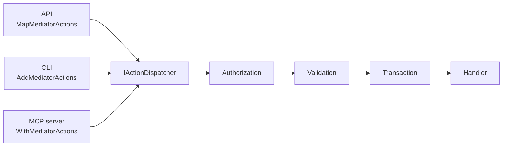

# Use cases

## One business layer for an API, a CLI and an AI agent

The problem: the same operations, such as creating, listing and cancelling invoices, are needed by a web front end, by operators in a terminal, and by an AI assistant. Writing an endpoint, a command and a tool for each, with authorization and validation repeated in each, multiplies the code and the chances of a rule being missed in one of them.

The approach:
1. Put the operations in a business layer, as [actions](actions.md) with handlers, validators and authorizers.
2. Register them once, in a method every host calls, such as `AddInvoicing()`.
3. Give each host one line: `MapMediatorActions`, `AddMediatorActions` or `WithMediatorActions`, and the right [principal accessor](authorization.md#the-current-user).



A new action becomes available everywhere at once, with the same rules. The [samples](../samples/README.md) are exactly this.

## Giving an AI agent less power than its user

An agent can misread an instruction, or be manipulated by text it reads, such as a malicious invoice description. Limit what it can do, independently of the user:

```csharp
// The agent's principal: the user's name, but without the Finance role.
var agent = new ClaimsPrincipal(new ClaimsIdentity([new Claim(ClaimTypes.Name, user.Name), new Claim("agent", "true")], "agent"));
services.AddFixedPrincipalAccessor(agent);

// And only the tools it needs.
.WithMediatorActions(o => o.Filter = a => a.Kind is ActionKind.Query or ActionKind.StreamQuery);
```

Authorizers can also check for the `agent` claim, to refuse specific actions to agents even when the user could run them.

## Background jobs

A nightly job that cancels invoices unpaid for a year has no user. Two options:

**System-only actions.** Mark the action as anonymous, and hidden from hosts, so only your code can send it:

```csharp
[Action("invoices.cancel-expired", "Cancels the open invoices whose due date has passed.", Hidden = true)]
[AllowAnonymousAccess]
public sealed record CancelExpiredInvoices : ICommand;
```

```csharp
public sealed class ExpiredInvoicesJob(IServiceScopeFactory scopes) : BackgroundService
{
    protected override async Task ExecuteAsync(CancellationToken ct)
    {
        using var timer = new PeriodicTimer(TimeSpan.FromHours(24));
        do
        {
            await using var scope = scopes.CreateAsyncScope();   // one scope per run
            await scope.ServiceProvider.GetRequiredService<IMediator>().SendAsync(new CancelExpiredInvoices(), ct);
        }
        while (await timer.WaitForNextTickAsync(ct));
    }
}
```

**A service account.** In an app that uses `HttpPrincipalAccessor`, write your own accessor that falls back to a service account outside requests, and register it instead:

```csharp
public sealed class HttpOrServicePrincipalAccessor(IHttpContextAccessor http) : IPrincipalAccessor
{
    private static readonly ClaimsPrincipal Service = new(new ClaimsIdentity(
        [new Claim(ClaimTypes.Name, "invoicing-jobs"), new Claim(ClaimTypes.Role, "System")], "service"));

    public ClaimsPrincipal? Principal => http.HttpContext?.User ?? Service;
}

services.AddHttpContextAccessor();
services.AddScoped<IPrincipalAccessor, HttpOrServicePrincipalAccessor>();
```

Authorizers then grant the `System` role exactly what jobs need.

## Calling an external API from a command

Charging a card, sending an email or posting to another system can't be rolled back, and may be repeated by EF Core retries. Save first, then call out, with an idempotency key:

```csharp
[NonTransactional]
[Action("invoices.charge", "Charges an invoice to the customer's card.")]
public sealed record ChargeInvoice(Guid Id) : ICommand;

public sealed class ChargeInvoiceHandler(InvoicingDbContext db, IPayments payments) : ICommandHandler<ChargeInvoice>
{
    public async ValueTask HandleAsync(ChargeInvoice command, CancellationToken ct = default)
    {
        var invoice = await db.Invoices.SingleAsync(i => i.Id == command.Id, ct);
        invoice.Status = InvoiceStatus.Charging;
        await db.SaveChangesAsync(ct);

        // The payment provider ignores a second request with the same key.
        await payments.ChargeAsync(invoice.Amount, idempotencyKey: invoice.Id.ToString(), ct);

        invoice.Status = InvoiceStatus.Paid;
        await db.SaveChangesAsync(ct);
    }
}
```

See [Transactions](transactions.md#side-effects-and-retries) for why.

## Splitting a large application into modules

Each module registers its own handlers, and they all end up in one mediator and one action catalog:

```csharp
services.AddMediator(o => o.AddHandlersFromAssemblyContaining<InvoicingModule>());
services.AddMediator(o => o.AddHandlersFromAssemblyContaining<CustomersModule>());
```

Register shared behaviours once, in the host. Action names must be unique across modules, so prefix them with the module's name, such as `invoices.` and `customers.`. A clash fails at startup.
